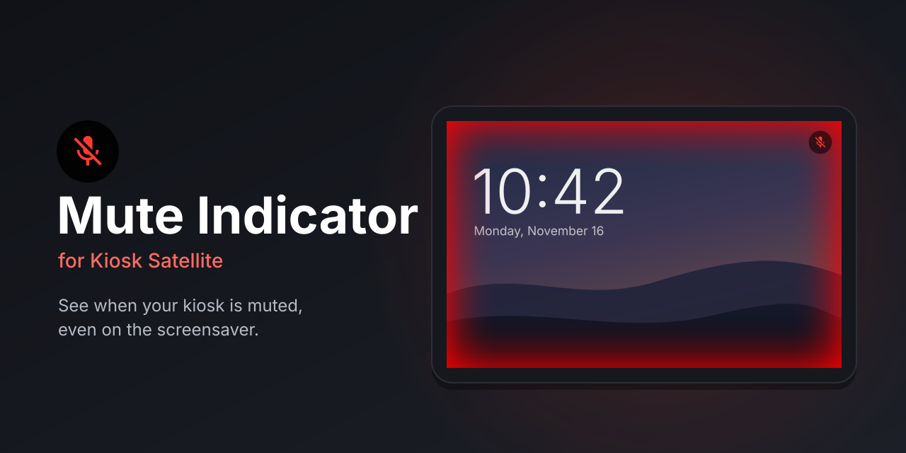
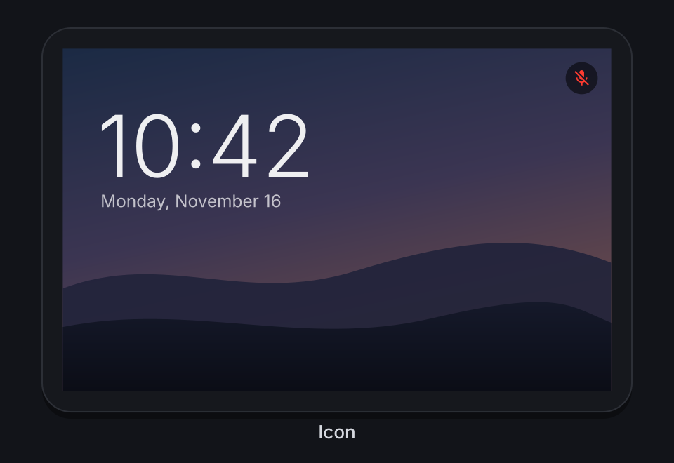
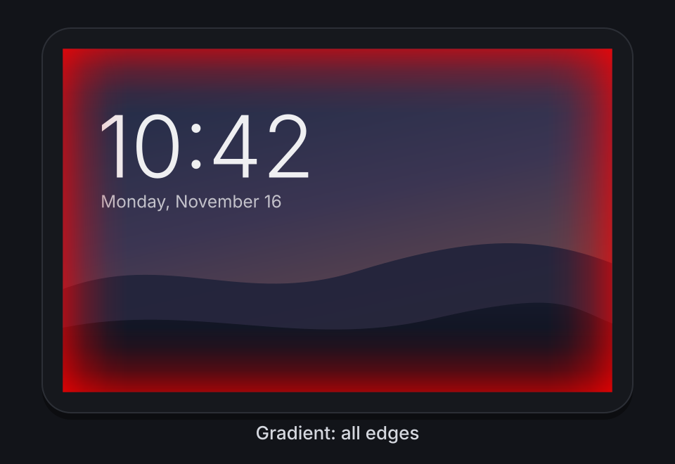
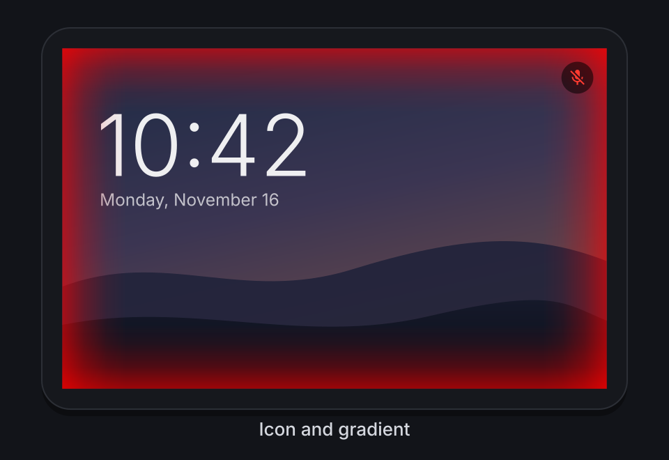
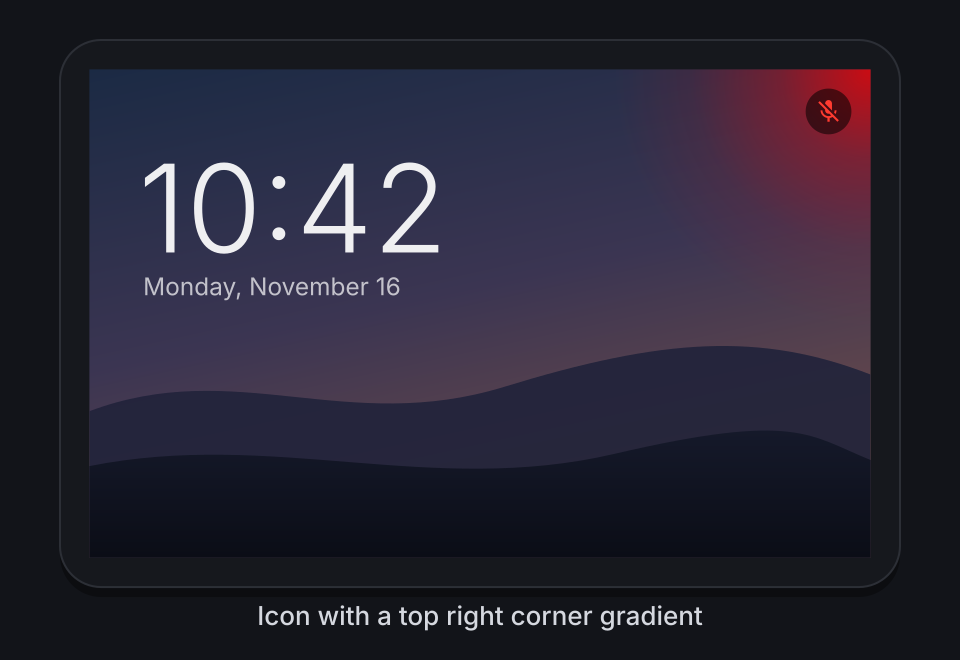

<p align="center"></p>

# Mute Indicator

A [Kiosk Satellite](https://github.com/jxlarrea/kiosk-satellite) plugin that shows when your kiosk's microphone is muted, so you can tell from across the room, even while the screensaver is up.

- **A mute symbol** that you can place anywhere on the screen and size, with your own colour, opacity and an optional background.
- **A red glow** that fades in from one edge, all four edges or a corner, with its own size, colour and opacity.
- **Either or both** at once.
- **Shows everywhere:** over the dashboard, the screensaver, the menu and camera views, or only on the screensaver, or only while it's off.
- **Never in the way:** every touch passes straight through, so tapping still wakes the screensaver and the dashboard still works.
- **Works without Home Assistant:** by default it follows the kiosk's own Voice Satellite mute, the same mute as its **VS Mute** switch in Home Assistant, so it stays accurate when Home Assistant is offline. It can follow any Home Assistant entity instead.
- **Live preview:** the indicator shows for a few seconds when you open its settings and after each change, so you can see the result as you go.

| Icon | Gradient |
| --- | --- |
|  |  |
| **Icon and gradient** | **Icon with a corner gradient** |
|  |  |

<sub>Illustrations of the default looks. Your screensaver, colours and positions will differ.</sub>

## Requirements

- Kiosk Satellite **2026.10.40** or newer, on a device with a screen.
- To follow the kiosk itself (the default): Voice Satellite turned on in Kiosk Satellite.
- To follow a Home Assistant entity: Kiosk Satellite connected to Home Assistant.

## Installation

### Community Plugins (Recommended)

Mute Indicator is listed in [Community Plugins](https://kiosksatellite.com/plugins/). Use the button below to open it in your Kiosk Satellite and install it.

[](https://kiosksatellite.com/redirect/plugin/?repository=MessyBobHome/kiosk-satellite-mute-indicator)

Or search for `Mute Indicator` in **Settings > Plugin Manager > Browse plugins** in Kiosk Satellite.

### Manual

1. Open **Settings > Plugin Manager** in Kiosk Satellite and turn on **Enable Plugins**.
2. Choose **Add plugin**, paste `https://github.com/MessyBobHome/kiosk-satellite-mute-indicator` and choose **Preview**.
3. Review the plugin and choose **Trust and install**.

New plugins start switched off, so turn it on afterwards. To try a local build instead, use **Plugin Manager > Developer Tools > Install from ZIP** with the ZIP from `dist/`. See [Build from source](#build-from-source).

## Privacy

Mute Indicator sends no data anywhere. It has no network code of its own and never contacts any server or service.

- **Following this kiosk** (the default), it reads the mute state from Kiosk Satellite on the device itself.
- **Following a Home Assistant entity**, it reads that one entity's state through Kiosk Satellite's existing Home Assistant connection. It only reads. It never calls services or changes anything in Home Assistant, and it never sees Kiosk Satellite's Home Assistant token.

It also reads whether the screensaver is showing, to apply the **Show** setting. Its settings stay on the kiosk.

It asks Kiosk Satellite for two capabilities: `overlay`, to draw the indicator, and `host.read`, to read the mute and screensaver state.

## Set it up

Open the plugin's page in **Plugin Manager**. The indicator shows for 15 seconds when the page opens and again after each change, so you can position and size it as you go. It then hides on its own, and at once when you close the page. Otherwise it shows only while the kiosk is muted.

### Mute source

| Setting | Default | What it does |
| --- | --- | --- |
| Follow | This kiosk | **This kiosk** follows Voice Satellite's microphone mute directly. **Home Assistant entity** follows the entity you pick. |
| Entity | | Shown with Home Assistant entity. For example `switch.echo_show_8_vs_mute`. |
| Muted when the state is | `on` | The state that means muted. Separate several with commas. `unknown` and `unavailable` never count as muted. |

### Indicator

| Setting | Default | What it does |
| --- | --- | --- |
| Indicator | Icon | **Icon**, **Gradient** or **Icon and gradient**. |
| Show | Everywhere | **Everywhere**, **Only on the screensaver** or **Only when the screensaver is off**. |
| Fade in and out (ms) | 400 | How long it takes to fade in on mute and out on unmute, 50 to 1000. |
| Pulse while muted | Off | Gently pulses instead of holding steady. Uses more power on slower devices. |
| Preview while editing | On | Shows the indicator for 15 seconds when the settings page opens, on the kiosk or in Remote Admin, and after each change. |

### Icon

| Setting | Default | What it does |
| --- | --- | --- |
| Symbol | `mdi:microphone-off` | Any Material Design Icon. |
| Position | Top right | Any corner, the middle of any edge, or the center. |
| Size (dp) | 56 | 16 to 320. |
| Distance from the edge (dp) | 24 | How far it sits from the screen edges. |
| Move right / Move down (dp) | 0 | Fine-tune the position. Negative values move left or up. It always stays on screen. |
| Colour | `#FF3B30` | The symbol's colour. |
| Opacity (%) | 100 | Applies to the symbol and its background together. |
| Background | Circle | **Circle**, **Rounded square** or **None**. A background keeps the symbol readable over photos. |
| Background colour / opacity | `#000000`, 55% | The background shape's colour and opacity. |

### Gradient

| Setting | Default | What it does |
| --- | --- | --- |
| Position | All edges | **Top**, **Bottom**, **Left** or **Right edge**, **All edges**, or any corner. |
| Size (dp) | 120 | How far the glow reaches in from its edge or corner, 20 to 800. |
| Colour | `#FF0000` | The glow's colour. |
| Opacity (%) | 60 | How strong the glow is at the edge, 5 to 100. |

Sizes are in dp, so they follow the kiosk's **Scale UI** setting like the rest of Kiosk Satellite.

## Preview action

**Preview the indicator for 10 seconds** shows the indicator whatever the mute state, then hides it again. Running it again restarts the 10 seconds. If the kiosk is muted, the indicator stays. Run it from **Gestures > Run a plugin action**, add it to the kiosk drawer or expose it as a button in Home Assistant from the plugin's page, or link to it from a dashboard button:

```
ks://plugin/mute-indicator/preview
```

## Good to know

- **What covers it.** The indicator draws where Kiosk Satellite's own voice overlay does, above the dashboard, the screensaver, the menu and camera views. Notifications, intercom call cards, announcements, the voice overlay itself, Lockdown Mode and a screensaver that blanks the screen to black still draw over it.
- **Other apps.** Like every plugin overlay, it shows only while Kiosk Satellite is on screen.
- **Following an entity.** The indicator shows Home Assistant's view of the entity. While Kiosk Satellite can't reach Home Assistant it stays hidden and the plugin's page says why, rather than guessing. Following **This kiosk** avoids this.
- **Screenshots.** Remote Admin screenshots can leave plugin overlays out. To capture what the panel really shows, use `adb exec-out screencap -p > screen.png`.

## Troubleshooting

The plugin's page in Plugin Manager always shows what it is following and whether the kiosk is muted.

| The page says | Try this |
| --- | --- |
| Couldn't read the kiosk's mute state | Turn on Voice Satellite in Kiosk Satellite, or follow a Home Assistant entity instead. |
| Pick the Home Assistant entity to follow | Choose an entity under **Mute source**. |
| *entity* is missing | Kiosk Satellite's Home Assistant user can't see that entity. Check the entity ID, or that it isn't restricted. |
| *entity* is disconnected | Kiosk Satellite can't reach Home Assistant. Check its Home Assistant connection. |
| Muted, but nothing shows | Check **Show**, and that the icon or gradient opacity isn't too low. Some screensaver modes blank the screen to black, which covers the indicator. |

## Build from source

You need Python 3, JDK 17 or newer, and an Android SDK with platform 35 and build-tools 35. Set `ANDROID_HOME` (and `JAVA_HOME` if needed), then:

```sh
python3 tools/test.py
python3 tools/build.py --android-platform 35
```

The installable ZIP is written to `dist/`. To check that the bundled SDK interfaces still match Kiosk Satellite, run `python3 tools/check-sdk.py /path/to/kiosk-satellite`.

## Publish a release

Kiosk Satellite installs plugins only from release files that GitHub Actions built, so never attach files by hand.

1. Commit your changes and push them to GitHub.
2. Create a release with a tag such as `v1.0.0`, and publish it as the latest release (not a draft or prerelease).
3. The included workflow tests and builds the plugin and attaches the ZIP, its checksum and the manifest to the release.

The tag sets the version, so you don't need to edit it in `kiosk-satellite-plugin.json`.

### Submit to Community Plugins

Once a release is published:

1. Run the same check the submission runs, from a clone of [kiosk-satellite-plugins](https://github.com/jxlarrea/kiosk-satellite-plugins):

    ```sh
    python3 tools/community_plugins.py check https://github.com/MessyBobHome/kiosk-satellite-mute-indicator
    ```

2. Open a [Submit a plugin](https://github.com/jxlarrea/kiosk-satellite-plugins/issues/new?template=submit-plugin.yml) issue from the account that owns this repository and paste the repository URL.
3. Fix anything the check reports, then edit the issue to run it again. A maintainer reviews the code before it's listed.

## Credits and license

- Built on the [Kiosk Satellite plugin SDK](https://github.com/jxlarrea/kiosk-satellite-plugins) by Javier Larrea. The SDK interfaces in `sdk/` and the tools in `tools/` are Apache-2.0.
- The microphone-off symbol in the artwork is from [Material Design Icons](https://pictogrammers.com/library/mdi/) by Pictogrammers, Apache-2.0. On the kiosk, the plugin draws icons from Kiosk Satellite's own icon set.
- `docs/art/make_art.py` regenerates the artwork with `rsvg-convert`.

AI disclosure: This plugin was developed with substantial help from AI (Anthropic’s Claude), which wrote most of the code, documentation and artwork under my direction. I have reviewed and tested it, but please report any issues you find.

Mute Indicator is released under the [Apache License 2.0](LICENSE).